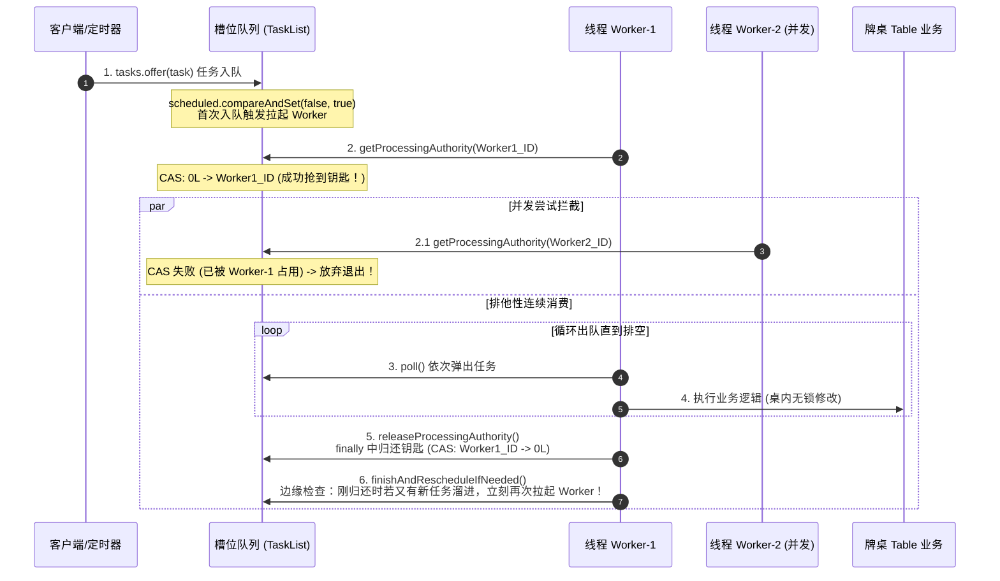

# utils.concurrent 线程架构与并发调度核心手册

> **架构升级说明**：原错别字包 `threadtutil` 已在本次全局重构中彻底废弃并移除，所有并发执行器与定时组件全面升级为标准领域包 **`utils.concurrent.*`**（划分为 `lock`, `thread`, `timer` 子包），时间与时区工具统一由 **`utils.time.TimeUtils`** 接管。

`utils.concurrent` 是项目底层最核心的通用并发调度与定时引擎，支撑着 `hub`（一体化服务）及游戏对局、大厅、网关的稳定运行。

本文档深入复盘并推导重构了本系统的**全局线程分流模型、双层队列架构、单桌无锁串行、拉起 Worker 机制、脉冲心跳模型、同槽位哈希碰撞队头阻塞痛点，以及高帧率（30/60帧）演进路线**。

---

## 目录
- [一、Hub 全局线程分流与角色分工](#一hub-全局线程分流与角色分工)
- [二、核心并发引擎：双层队列与“拉起 Worker”机制](#二核心并发引擎双层队列与拉起-worker机制)
  - [1. 业务与物理双层队列拓扑](#1-业务与物理双层队列拓扑)
  - [2. 什么是“拉起 Worker”？](#2-什么是拉起-worker)
  - [3. 单槽排他执行与 CAS 令牌流转](#3-单槽排他执行与-cas-令牌流转)
  - [4. 工作窃取（Work-Stealing）安全调度](#4-工作窃取work-stealing安全调度)
- [三、牌桌心跳（Tick）与状态机运转模型](#三牌桌心跳tick与状态机运转模型)
  - [1. 为什么 Worker 不会被心跳卡死？（离散脉冲模型）](#1-为什么-worker-不会被心跳卡死离散脉冲模型)
  - [2. 毫秒级时间轴全解（0ms ~ 1ms ~ 500ms）](#2-毫秒级时间轴全解0ms--1ms--500ms)
  - [3. `tickBusy` 防雪崩与防连环追尾机制](#3-tickbusy-防雪崩与防连环追尾机制)
  - [4. 牌桌停服与心跳安全注销](#4-牌桌停服与心跳安全注销)
- [四、架构局限与痛点深度剖析（深入 Q&A）](#四架构局限与痛点深度剖析深入-qa)
  - [1. 痛点一：同槽位其他桌子被连累阻塞（哈希碰撞）](#1-痛点一同槽位其他桌子被连累阻塞哈希碰撞)
  - [2. 痛点二：漏一次心跳能做一秒 30 帧 / 60 帧吗？](#2-痛点二漏一次心跳能做一秒-30-帧--60-帧吗)
- [五、慢任务雷达监控与卡死现场抓取](#五慢任务雷达监控与卡死现场抓取)
- [六、外部统一调用 API 规范与实战范式](#六外部统一调用-api-规范与实战范式)
- [七、未来架构演进与优化指南](#七未来架构演进与优化指南)
- [八、研发铁律与避坑准则](#八研发铁律与避坑准则)

---

## 一、 Hub 全局线程分流与角色分工

Hub 进程通过 `GameThreadPoolManager` 统筹核心执行器，实现**业务纯内存运算、阻塞数据库落盘与准时时钟脉冲的彻底物理隔离**。

可以形象地把整个 Hub 视作一个**大型自动化工厂**：
- **队列** = 传送带 / 暂存货架（负责缓冲和严格排队）；
- **线程池里的线程** = 工人（负责干活）。

```
+-----------------------------------------------------------------------------------------+
|                                      Hub 工厂全局拓扑                                    |
+-----------------------------------------------------------------------------------------+

 [客户端 WebSocket] --- JSON 报文 ---> (1) 网络接入层 (Tomcat / Netty IO 线程)
                                                  |
                                                  v
                       +---------------------------------------------+
                       | (2) 业务亲和池 (Game-Business / ExecutorPool)|
                       |                                             |
                       |  [槽位 0 传送带]  [槽位 1 传送带] ...         | <--- 上层: 1024条桌子专用无锁队列 (TaskList)
                       |        \               /                    |
                       |     [ 32个全能 Worker 物理工人 ]             | <--- 专门跑棋牌对局、出牌、状态机
                       |                 |                           |
                       |     [ 底层公共任务调度大队列 ]                | <--- 底层: 存放"派工单" (LinkedBlockingQueue)
                       +-----------------+---------------------------+
                                         |
                        +----------------+----------------+
                        |                                 |
                        v                                 v
          (3) 数据库异步池 (databasePool)      (4) 定时脉冲闹钟 (tableScheduler)
          [ 4~8个搬砖工人 + 阻塞等待队列 ]         [ 1个极简钟表匠 + 最小堆时间队列 ]
          专门跑 SQLite 慢写盘，不拖累车间         不干任何杂活，只负责准时打节拍
```

### 核心线程池矩阵

| 线程池名称 | 线程在干嘛？（工人） | 队列在干嘛？（传送带） | 为什么这样设计？ |
| :--- | :--- | :--- | :--- |
| **`Game-Business`**<br/>(统一业务亲和池，32 线程) | **纯内存状态机计算**。<br/>执行出牌规则校验、摸牌、算番、判定胡牌、广播消息。 | **双层队列架构**：<br>① **上层（1024个 `TaskList` 无锁逻辑槽位）**：按 `tableId` 位运算扰动散列，**实现同桌天然单线程串行且极少碰撞**！<br>② **底层（`LinkedBlockingQueue`）**：存放“派遣工人去某槽”的调度指令。 | 既保证了同一桌**绝对无并发冲突、零死锁**，又能利用 32 个线程让不同桌并发跑，还能工作窃取压榨多核。 |
| **`Game-Database`**<br/>(数据库异步池，4~8 线程) | **专门做慢磁盘 I/O**。<br/>执行 SQLite 战绩落盘、结算数据持久化、写日志文件。 | **任务缓冲队列**。<br/>桌子打完后把写入请求往队列一扔，业务工人就去开下一局了，由 DB 工人慢慢往磁盘写。 | **物理隔离**。SQLite 有写锁，如果磁盘卡顿 100ms，只卡住 DB 工人，**主对局业务毫秒不卡**。 |
| **`Game-TableScheduler`**<br/>(定时脉冲闹钟，单线程) | **纯粹看表的“钟表匠”**。<br/>本身**绝对不执行任何游戏逻辑**！只负责数毫秒，时间一到就向业务池投递一个脉冲。 | **基于最小堆的时间队列** (`DelayedWorkQueue`)。<br/>按到期时间排序，时间最近的桌子排在最前面。 | 保证心跳节奏极度精准，绝对不被繁重的业务计算拖慢钟表自身。 |
| **网络接入池**<br/>(Tomcat / Netty) | **迎宾门童**。<br/>监听客户端 WebSocket，解析收到的一串 JSON 文本，组装成 Java 对象后立刻移交给业务池。 | **网络 I/O 缓冲区**。<br/>暂存客户端发上来的原始 TCP 字节流。 | 让网络 IO 线程只做编解码，不碰游戏业务逻辑。 |

---

## 二、 核心并发引擎：双层队列与“拉起 Worker”机制

### 1. 业务与物理双层队列拓扑

传统设计要么“一个大队列所有线程抢”（锁竞争激烈），要么“给每张桌子开物理线程”（几百张桌子导致几百个线程上下文切换崩溃）。

`utils.concurrent` 采用**双层分离架构**：
```
【上层：逻辑业务槽位】
  桌子 1001 号 ----(取模哈希)----> [ 槽位 1 : TaskList ] ---> [出牌] -> [准备] (单桌任务 FIFO)
  桌子 1002 号 ----(取模哈希)----> [ 槽位 2 : TaskList ] ---> [碰牌]          (单桌任务 FIFO)
                                         |
                                         | 槽位有任务且未调度时，向底层下发派工单
                                         v
【底层：物理调度大队列】
  LinkedBlockingQueue: [ "去消费槽位1" ] -> [ "去消费槽位2" ]
                                         ^
                                         | 抢单消费
  32个物理 Worker 线程: [ Worker-1 ]  [ Worker-2 ] ... [ Worker-32 ]
```

---

### 2. 什么是“拉起 Worker”？

**概念定义**：
“拉起 Worker” 就是当某个槽位从【空闲无活】变成【有新任务】时，向底层物理线程池提交一个 Runnable 派工闭包：
```java
// 这行代码就是所谓的“拉起 Worker”
this.threadPool.execute(() -> processTasks(slotIndex));
```
底层线程池接到派工单后，会立刻**唤醒一个空闲的物理线程**去执行该槽位。

#### 为什么不能“每来一个任务就拉起一次”？（防惊群）
如果 4 个玩家在 1ms 内同时发来出牌/操作：
- 如果每来一个任务都调用 `threadPool.execute()`，线程池会收到 4 张派工单；
- 第 1 个工人进去把 4 个任务一口气做完了；
- 后面 3 个工人赶过来发现队列已经是空的，白跑一趟（CPU 白白浪费在线程唤醒与上下文切换上）。

**门禁解决方案：`scheduled.compareAndSet(false, true)`**
```
外部提交任务 (tasks.offer(taskNode))
        |
        v
scheduled.compareAndSet(false, true)
       /                             \
此前是 true (已有工人)             此前是 false (当前空闲)
      /                                 \
【不重复拉起】                      【正式拉起 Worker！】
任务安心排队即可，现有工人顺手做完     threadPool.execute(() -> processTasks(slotIndex))
```

---

### 3. 单槽排他执行与 CAS 令牌流转

工人进场后，如何确保**任意时刻绝不会有两个工人同时跑同一张桌子**？

在 `TaskList` 中通过 `AtomicLong processor` 实现**单槽排他令牌（Authority）**：



---

### 4. 工作窃取（Work-Stealing）安全调度

工人清空自己负责的槽位后，**不会立刻休眠**，而是发起环形巡视：

```text
 Worker-1 处理完 [槽位 0] 的全部任务后：
 
 巡视第 1 站：【槽位 1】 ---> 状态: 忙碌 (Worker-2 正在处理) ----> 跳过！绝不破坏单桌串行
 巡视第 2 站：【槽位 2】 ---> 状态: 堆积了 3 个任务且无人处理 ---> 发现目标！
                             动作: Worker-1 CAS 抢下槽位 2 的处理权，一口气消费完！
 巡视第 3 站：【槽位 3】 ---> 状态: 空队列 --------------------> 跳过。
```

> [!IMPORTANT]
> **窃取准则**：窃取的是**整条空闲队列**，绝不会从“正被其他线程处理”的队列中偷取单个任务！

---

## 三、 牌桌心跳（Tick）与状态机运转模型

### 1. 为什么 Worker 不会被心跳卡死？（离散脉冲模型）

很多初学者容易误解：*“如果心跳一直在跑，队列里岂不是永远有任务？那 Worker 线程岂不是死循环在里面永远出不来了？”*

**答案是：绝对不会！因为心跳不是一个死循环，而是像“钟摆节拍”一样，每隔 500 毫秒才往队列里扔“1 个”微型任务。**

这个微型任务执行只需要 **不到 1 毫秒**，执行完后队列立刻变为空，Worker 线程会马上退出循环并释放处理权。

---

### 2. 毫秒级时间轴全解（0ms ~ 1ms ~ 500ms）

```
时间轴 (毫秒)
 0ms                     1ms                                      500ms
  |-----------------------|-----------------------------------------|------------------->
  ^                       ^                                         ^
  |                       |                                         |
[闹钟 tableScheduler]   [Worker 瞬间处理完]                      [闹钟 tableScheduler]
往队列塞入 1 个 Tick 任务   队列重新变为空！(poll()==null)            发出下一拍脉冲，
(队列长度: 0 -> 1)       Worker 退出 while 循环并释放槽位钥匙      再次塞入 1 个任务
                          在这 499ms 的空白期内，队列彻底为空！
                          Worker 早就去干别的活或回池子休眠了！
```

- **任务出队即消费**：用的是 `ConcurrentLinkedQueue.poll()`，任务被弹出执行后就不在队列里了，根本不存在堆积，也无需手动删除；
- **Worker 优雅退出**：`while ((task = list.poll()) != null)`，跑完那 1 个心跳任务后，第二次 `poll()` 拿到的就是 `null`，瞬间跳出循环并归还处理权。

---

### 3. `tickBusy` 防雪崩与防连环追尾机制

**极端情况拷问**：假设某桌因为复杂逻辑，第 0ms 的心跳居然卡顿执行了 **1200ms**（远超 500ms 周期），后续心跳会连环追尾崩盘吗？

**答案是：被 `tickBusy` 丢弃机制当场拦截！**

```
时间轴:
0ms        500ms           1000ms          1200ms
 |-----------|---------------|---------------|----------------->
 ^           ^               ^               ^
第1拍执行中   第2拍闹钟响起    第3拍闹钟响起    第1拍终于执行完毕！
             [tickBusy 拦截]  [tickBusy 拦截]  释放 tickBusy 标记
             直接丢弃！       直接丢弃！
```

源码见 [GameThreadPoolManager.java](file:///d:/code/st/game-server/hub/src/main/java/com/cloud/hub/game/manager/thread/GameThreadPoolManager.java#L267-L286)：
```java
private void dispatchTick(long tableId, Runnable task) {
    if (!activeTables.contains(tableId)) return;
    
    // 【核心保护门禁】：原子标记防堆积！
    // tickBusy 是一个 ConcurrentHashMap.newKeySet()
    // 上一拍没跑完？add 返回 false，当场丢弃本拍！绝不堆积！
    if (!tickBusy.add(tableId)) {
        return; 
    }
    
    submitTable(tableId, () -> {
        try {
            task.run();
        } finally {
            tickBusy.remove(tableId); // 真正执行完才释放
        }
    });
}
**“宁可降频丢拍，绝不雪崩堆积！”** 等 1200ms 第 1 拍终于结束时，队列里干干净净，没有积压任何心跳。

#### 核心拷问：丢拍究竟丢了什么？状态机会漂移吗？
- **丢了什么**：**只丢弃了 1 次空转的闹钟催促脉冲（Tick 信号）**，**绝对没有丢弃**任何玩家出牌、吃碰杠、摸牌、手牌等业务数据。
- **为什么丢**：上一拍超时未完成时，新的脉冲纯属多余催促。当场丢弃就是为了**防雪崩连环追尾，降频自保**。
- **为什么状态机天然不漂移**：牌桌倒计时（如 15s 出牌超时）判定统一使用**系统绝对时间戳**（`System.currentTimeMillis() - stateStartTime >= timeoutMs`），而不是累计心跳执行次数。丢拍恢复后下一拍一查绝对时间戳自然与现实时钟对齐，**零漂移、零损失，天然无需任何手动补帧**。

---

### 4. 牌桌停服与心跳安全注销

牌桌解散或小局结算结束时：
1. **取消定时器**：调用 `pools.cancelTableSchedule(loopFuture)`，闹钟不再发脉冲；
2. **移出活跃集合**：调用 `pools.removeTable(tableId)`，从 `activeTables` 摘除，后续任何并发投递当场拒绝；
3. 槽位队列任务彻底清空，桌子随之被 GC 安全回收。

---

## 四、 架构局限与痛点深度剖析（深入 Q&A）

### 1. 痛点一：同槽位其他桌子被连累阻塞（哈希碰撞）

> **疑问**：如果有大量桌子在线，不同桌子算出来的槽位相同。**如果桌子 A 卡顿了，那跟桌子 A 在同一个槽位队列里的桌子 B，岂不是也会被连累卡顿？！**

**答案：这是哈希槽架构的核心关注点——队头阻塞（Head-of-Line Blocking）。为此，系统在底层原生实现了“1024 高维逻辑槽位与 32 物理 Worker 解耦”：**

```
       Table-1  ───► (tableId ^ (tableId >>> 16)) & 1023 ───► [ 槽位 1 队列 ]
       Table-33 ───► (tableId ^ (tableId >>> 16)) & 1023 ───► [ 槽位 890 队列 ] (天然散列打散！)
       
+-------------------------------------------------------------------------------+
|                            1024 个 TaskList 无锁 FIFO 队列                    |
+-------------------------------------------------------------------------------+
  Slot 1  : [Table-1 出牌] ---> [Table-1 心跳(卡死2秒)]
  Slot 890: [Table-33 正常出牌] (完全处于独立槽位，零等待、零卡顿、零受牵连！)
```

#### 项目是如何杜绝和防范这个问题的？
1. **1024 高维逻辑槽位解耦**：物理 Worker 保持 32 线程，逻辑槽位扩展至 1024 槽（碰撞率由 32 槽的 ~85.2% 骤降至 **~4.7%**），绝大多数桌子天然独占队列；
2. **位运算扰动路由**：使用 `(groupId ^ (groupId >>> 16)) & 1023`，纳秒级寻址且彻底杜绝负数越界；
3. **铁律：业务 Worker 绝对禁止任何阻塞 I/O**！算牌、碰杠是纯内存运算（通常耗时仅 0.001ms ~ 0.01ms），即使极小概率同槽排队，总耗时也不到 0.1ms；
4. **所有磁盘读写物理隔离到 `databasePool`**；
5. **内置超时雷达**：单槽卡顿超过 5s 报警告，超过 60s 直接 dump 现场调用堆栈抓出卡死代码。

---

### 2. 痛点二：漏一次心跳能做一秒 30 帧 / 60 帧吗？

> **疑问**：前面说心跳慢了会自动“漏掉/丢弃”上一拍。那如果做一秒 30 帧或 60 帧的实时对战游戏，这套模型能做吗？

> **结论：当前的这套架构做棋牌（1秒 2 帧）极度稳健优秀；但如果直接拿来做“1秒 30 帧 / 60 帧”的实时竞技/动作帧同步，是【不能直接用】的，必须做架构重构！**

#### 本质区别与为什么不能直接用：

| 维度 | 棋牌 / 回合制（当前架构，2 Hz） | 动作 / MOBA / 射击（30/60 Hz 帧同步） |
| :--- | :--- | :--- |
| **心跳语义** | **辅助计时**：主要靠玩家操作事件驱动。漏一拍心跳无非是 15s 出牌倒计时晚了半秒，**玩家无感知**。 | **世界推进核心**：每帧带严格自增的 **Frame ID**！负责位移、物理碰撞。**漏一帧就是世界少算了 16ms**，客户端瞬间瞬移、卡死、不同步！ |
| **时钟精度** | 500ms 级别，Java 时钟片 ±5ms 抖动完全无所谓。 | 16.6ms 一帧！±5ms 抖动意味着帧率在 45~80 帧剧烈震荡，画面顿挫感极强。 |
| **GC 与调度** | 1000 桌每秒产生 2000 个任务，轻量极快。 | 1000 桌每秒产生 60,000 个任务！CAS 竞争与 JVM Young GC 瞬间被打爆。 |

---

## 五、 慢任务雷达监控与卡死现场抓取

`ExecutorPool` 内置了两级执行时间雷达，杜绝任何因死循环、死锁或慢 SQL 拖死 Worker 线程的情况：

```text
 [任务开始执行]
       │
       ▼
 [耗时 > 5000ms]  ──► 触发一级告警：打印 ERROR 慢任务警告，输出 slot、持有线程 ID 及耗时
       │
       ▼
 [耗时 > 60000ms] ──► 触发二级快照：判定为严重死锁/卡死，直接抓取并 Dump 现场完整线程堆栈！
```

日志输出示例：
```log
2026-09-22 14:30:00 ERROR [ExecutorPool 慢任务警告] 槽位:3 处理时间过长! 持有线程:[15:Game-Business_3] 已持续耗时:5230ms
2026-09-22 14:31:00 ERROR 卡死线程堆栈 Dump [ID:15 Name:Game-Business_3]:
  at com.cloud.hub.game.domain.mj.MjPlayService.calculateFan(MjPlayService.java:188)
  at com.cloud.hub.game.domain.table.Table.tableLoop(Table.java:410)
  ...
```

---

## 六、 外部统一调用 API 规范与实战范式

### 1. 核心调度方法速查（API 矩阵）

| 调用场景 | 核心方法 | 返回类型 | 适用职责与特性 |
| :--- | :--- | :--- | :--- |
| **牌桌串行任务** | `table.execute(Runnable)` | `CompletableFuture<Void>` | 状态机流转、打牌、摸牌等无返回值写操作 |
| **牌桌计算/查询** | `table.execute(Supplier<T>)` | `CompletableFuture<T>` | 牌桌只读快照、结算数据获取等有返回值操作 |
| **带切面排错任务** | `table.execute(String, Runnable)` | `CompletableFuture<Void>` | 自动打印操作名与 tableId 的异常切面，无需手写 `.exceptionally` |
| **Handler 调度（静默）** | `TableHandlerHelper.dispatch(tableId, name, action)` | `boolean` (恒为 true) | 查桌、判空、桌串行投递、异常隔离四合一，桌不存在时静默忽略 |
| **Handler 调度（回错）** | `TableHandlerHelper.dispatchOrReplyNull(sender, tableId, name, action)` | `boolean` (恒为 true) | 查桌并调度；若桌不存在则自动向客户端发送 `TABLE_NULL_VALUE` 错误码 |
| **玩家独立会话串行** | `pool.serialExecute(userId, Runnable/Supplier)` | `CompletableFuture<Void/T>` | 个人属性变动、背包购买，同 userId 绝对串行防并发 |
| **周期心跳调度** | `pools.scheduleTable(tableId, tick, delay, interval)` | `ScheduledFuture<?>` | 牌桌周期 Tick，自带 `tickBusy` 防上一拍堆积 |

---

### 2. 标准实战代码示例

#### 牌桌与玩家端标准调用
```java
// 1. 同桌串行投递（写操作）
table.execute(() -> {
    table.processPlayCard(userId, card);
});

// 2. 同桌串行计算（读操作，直接异步链式流转）
table.execute(() -> table.buildRoomTableInfo())
     .thenAccept(info -> sender.sendMessage(info));

// 3. 自带语义化异常切面的桌投递（发生未捕获异常时自动打印 ERROR 日志）
table.execute("玩家出牌", () -> {
    table.processPlayCard(userId, card);
});

// 4. 玩家个人会话串行投递（传入 userId 与 Lambda）
executorPool.serialExecute(userId, () -> {
    player.updateScore(100);
});

// 5. 普通非串行异步任务（直接扔到底层物理线程池）
executorPool.execute(() -> {
    logger.info("异步统计上报");
});
```

#### Handler 层统一接入范式
```java
@ProcessType(GMsg.REQ_OP)
public class ReqOpHandle implements Handler {
    @Override
    public boolean handler(Sender sender, int clientId, Message message, long mapId, int sequence) {
        GameProto.ReqOp request = (GameProto.ReqOp) message;
        // 若桌子不存在，dispatchOrReplyNull 会自动回发 TABLE_NULL_VALUE 并打日志
        return TableHandlerHelper.dispatchOrReplyNull(sender, mapId, "玩家操作", table -> {
            int result = table.processOp(clientId, request.getOp(), sender, mapId, sequence);
            replyOp(sender, clientId, mapId, sequence, request.getOp(), result);
        });
    }
}
```

---

## 七、 未来架构演进与优化指南

如果业务量进一步扩大，或需要支持高帧率实时竞技，以下是经过验证的演进路线：

### 优化 1：扩容槽位数（解决同槽连带阻塞的最简方案）
- **操作**：将固定槽位数从 32 扩容到 **256 或 1024**：
  ```java
  this.taskLists = new TaskList[1024];
  ```
- **收益**：哈希碰撞概率从 1/32 下降至 1/1024。几乎零改动成本，同槽连带卡顿概率呈指数级下降。

### 优化 2：演进为独立 Actor Mailbox（彻底消除桌间干扰）
- **操作**：把 `TaskList` 下沉进 `Table` 实例本身。每张桌子持有一个私有的 `ConcurrentLinkedQueue`；
- 桌子有任务时，将**`Table` 本身作为调度单元**提交给物理 Worker 线程；
- **收益**：桌子之间队列彻底物理隔离。桌子 A 卡死 10 秒，其他所有桌子零影响。

### 优化 3：支持 30/60 帧实时竞技的专用架构改造
若拓展动作/实时对战玩法：
1. **采用 Dedicated Game Loop（独立自旋线程）**：
   Worker 线程绑定一组房间，使用高精度纳秒循环：
   ```java
   long nextTick = System.nanoTime();
   while (running) {
       long now = System.nanoTime();
       if (now >= nextTick) {
           updatePhysics(FIXED_DT);
           nextTick += 16_666_666L; // 严格累加 16.6ms
       }
   }
   ```
2. **定长追帧（Accumulator / Fixed Update）代替丢帧**：
   若某帧计算耗时卡顿了 33ms，**绝不丢帧**，而是在下一循环连续补算 2 帧追平物理时间，保证客户端不同步。
3. **零垃圾对象池（Zero-Allocation）**：高频更新的数据包和临时向量全部走对象池复用，杜绝 GC 顿挫。

---

## 八、 研发铁律与避坑准则

1. **同资源必须同 Key**：
   凡是修改同一桌子状态的操作（出牌、入桌、离桌、超时判定），必须传同一个 `tableId`，确保进入同一个串行槽位。
2. **业务 Worker 绝不跑阻塞 I/O**：
   写数据库、调 HTTP/RPC、`Thread.sleep()` 必须投递到 `databasePool` 或另外异步处理，严禁阻塞槽位 Worker。
3. **队列满时的反压行为（CallerRuns）**：
   当队列超过有界容量（10 万）时，底层采用 `CallerRunsPolicy`，由提交方线程（如网络 IO 线程）直接代为执行。这会自然放慢网络接收速率，形成正向背压，保护服务端不发生 OOM。
4. **负数 groupId 安全性**：
   内部使用 `Math.floorMod(groupId, slots)`，完全兼容 `hashCode` 为负数或 `Integer.MIN_VALUE` 的情况，永不数组越界。
