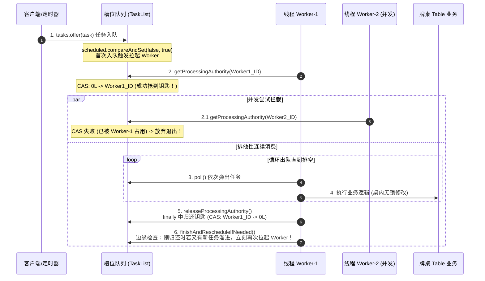

# utils.concurrent 线程架构与并发调度核心手册

> **架构定位**：`utils.concurrent` 是服务端底层最核心的通用并发调度、零 GC 对象池与定时调度引擎，统筹支撑 `hub`（一体化服务）及棋牌对局、大厅、网关的稳定高并发运行。  
> **单一本源说明**：本文档已全量融汇原实施草案中的三模设计、Actor 邮箱、Dedicated Loop 实时追帧、无锁对象池与排障基准，为本项目**唯一、最终权威的技术说明文档**。

---

## 目录
- [一、 并发设计哲学与系统全局拓扑](#一-并发设计哲学与系统全局拓扑)
  - [1. 自动化工厂类比与核心构件分工](#1-自动化工厂类比与核心构件分工)
  - [2. 全局线程角色与职能矩阵](#2-全局线程角色与职能矩阵)
- [二、 线程池（ThreadPool / ExecutorPool）体系深度解析](#二-线程池threadpool--executorpool体系深度解析)
  - [1. 什么是 ThreadPool？底层物理线程池运作机理](#1-什么是-threadpool底层物理线程池运作机理)
  - [2. 什么是 ExecutorPool？亲和串行化门面设计](#2-什么是-executorpool亲和串行化门面设计)
  - [3. 阻塞隔离池（databasePool）与单线程时钟源（tableScheduler）](#3-阻塞隔离池databasepool与单线程时钟源tablescheduler)
- [三、 队列（Queue）多维拓扑与流转机制](#三-队列queue多维拓扑与流转机制)
  - [1. 双层队列架构：上层 1024 槽 TaskList 与底层 LinkedBlockingQueue](#1-双层队列架构上层-1024-槽-tasklist-与底层-linkedblockingqueue)
  - [2. 纳秒级位运算哈希路由与负数越界杜绝](#2-纳秒级位运算哈希路由与负数越界杜绝)
  - [3. 去中心化 Actor Mailbox 队列（单实体独占无锁队列）](#3-去中心化-actor-mailbox-队列单实体独占无锁队列)
  - [4. 时钟队列（DelayedWorkQueue）与对象池空闲队列（idleQueue）](#4-时钟队列delayedworkqueue与对象池空闲队列idlequeue)
- [四、 线程（Worker）运转机理与调度协议](#四-线程worker运转机理与调度协议)
  - [1. 什么是“拉起 Worker”？防惊群门禁实现](#1-什么是拉起-worker防惊群门禁实现)
  - [2. 单槽排他执行与 CAS 令牌流转（单桌绝对串行且零死锁）](#2-单槽排他执行与-cas-令牌流转单桌绝对串行且零死锁)
  - [3. 带界限的随机偏置工作窃取（Work-Stealing）](#3-带界限的随机偏置工作窃取work-stealing)
- [五、 高性能零 GC 对象池（ObjectPool / PooledHandle）体系](#五-高性能零-gc-对象池objectpool--pooledhandle体系)
  - [1. 为什么需要对象池？高频 30/60 帧与高吞吐下的 GC 痛点](#1-为什么需要对象池高频-3060-帧与高吞吐下的-gc-痛点)
  - [2. ObjectPool 核心设计（无锁队列 + 容量门禁 + Recyclable 重置）](#2-objectpool-核心设计无锁队列--容量门禁--recyclable-重置)
  - [3. 怎么用？PooledHandle 与 try-with-resources 安全自动归还](#3-怎么用pooledhandle-与-try-with-resources-安全自动归还)
  - [4. 运行指标监控与命中率统计](#4-运行指标监控与命中率统计)
- [六、 核心协同机制与端到端处理逻辑（文字图 / ASCII 流程图）](#六-核心协同机制与端到端处理逻辑文字图--ascii-流程图)
  - [1. 全局流转协同大图（网络 -> 派工 -> 槽位 -> Worker -> 对象池 -> DB）](#1-全局流转协同大图网络---派工---槽位---worker---对象池---db)
  - [2. 客户端出牌指令全生命周期时序图](#2-客户端出牌指令全生命周期时序图)
  - [3. 牌桌心跳脉冲与状态机超时流转图（tickBusy 防雪崩与时间戳自愈）](#3-牌桌心跳脉冲与状态机超时流转图tickbusy-防雪崩与时间戳自愈)
  - [4. 专用实时循环定长追帧流转图（Mode 3 DEDICATED）](#4-专用实时循环定长追帧流转图mode-3-dedicated)
- [七、 三大运行模式自由切换手册（SLOTS / MAILBOX / DEDICATED）](#七-三大运行模式自由切换手册slots--mailbox--dedicated)
  - [1. 三模设计全景与适用选型矩阵](#1-三模设计全景与适用选型矩阵)
  - [2. 切换方式（启动参数 / Spring 配置 / 运行时动态 API）](#2-切换方式启动参数--spring-配置--运行时动态-api)
  - [3. 启动日志与巡检核验](#3-启动日志与巡检核验)
- [八、 核心 API 使用手册与业务实战范式](#八-核心-api-使用手册与业务实战范式)
  - [1. 调度方法速查矩阵](#1-调度方法速查矩阵)
  - [2. 业务端标准代码范式（牌桌、Handler、对象池）](#2-业务端标准代码范式牌桌handler对象池)
- [九、 并发风险与系统防范闭环（Rule 100 约束六大风险）](#九-并发风险与系统防范闭环rule-100-约束六大风险)
  - [1. 风险一：单桌耗时导致心跳丢拍时倒计时漂移](#1-风险一单桌耗时导致心跳丢拍时倒计时漂移)
  - [2. 风险二：高并发突发时底层派工队列溢出（CallerRuns 背压）](#2-风险二高并发突发时底层派工队列溢出callerruns-背压)
  - [3. 风险三：牌桌销毁（Dispose）临界期的并发任务挂起](#3-风险三牌桌销毁dispose临界期的并发任务挂起)
  - [4. 风险四：单桌高频指令霸占 Worker 导致的局部饥饿](#4-风险四单桌高频指令霸占-worker-导致的局部饥饿)
  - [5. 风险五：高精度实时循环自旋导致 CPU 100% 满载](#5-风险五高精度实时循环自旋导致-cpu-100-满载)
  - [6. 风险六：实时追帧超载引发“死亡螺旋”](#6-风险六实时追帧超载引发死亡螺旋)
- [十、 研发铁律与生产运维指南](#十-研发铁律与生产运维指南)
  - [1. 慢任务雷达监控与 60s 堆栈抓取](#1-慢任务雷达监控与-60s-堆栈抓取)
  - [2. 研发四大铁律](#2-研发四大铁律)

---

## 一、 并发设计哲学与系统全局拓扑

### 1. 自动化工厂类比与核心构件分工

为了彻底理清高并发架构中的概念混淆，可以将整个 `hub` 服务看作一个**大型现代化无人工厂**：

| 工厂组件 | 对应系统并发构件 | 核心职责与运作方式 |
| :--- | :--- | :--- |
| **车间工件 / 货物** | **任务（Task / Runnable / Supplier）** | 承载具体的计算逻辑（如玩家出牌、判定胡牌、生成结算战报）。 |
| **传送带 / 分拣货架** | **队列（Queue / TaskList / Mailbox）** | **只负责排队与缓冲，绝不干活**！确保工件按先进先出（FIFO）严格排队。 |
| **车间装配工人** | **物理线程（Thread / Worker）** | **干活的主体**。由操作系统分配 CPU 时间片，从队列里不断弹出任务执行。 |
| **车间管理调度室** | **线程池（ThreadPool / ExecutorPool）** | **管理工人团队与派工单**。统筹工人休眠、唤醒、拉起、扩缩容与工作窃取。 |
| **循环清洗周转箱** | **对象池（ObjectPool / PooledHandle）** | **提供重复使用的标准化容器**。用完清洗放回货架，杜绝频繁扔垃圾引发环卫工（JVM GC）停工。 |

---

### 2. 全局线程角色与职能矩阵

在 [GameThreadPoolManager.java](file:///d:/code/st/game-server/hub/src/main/java/com/cloud/hub/game/manager/thread/GameThreadPoolManager.java) 中，系统统筹划分出物理隔离的执行器矩阵：

```
+--------------------------------------------------------------------------------------------------+
|                                    Hub 全局线程与队列调度工厂                                     |
+--------------------------------------------------------------------------------------------------+

  [客户端 WebSocket] ─── JSON 报文 ───► 网络接入池 (Tomcat / Netty IO 线程，仅编解码)
                                                 │
                                                 ▼
                +─────────────────────────────────────────────────────────────+
                | 业务亲和池 (Game-Business / ExecutorPool)                    |
                |                                                             |
                |  [Slot 0 队列]   [Slot 1 队列]  ...   [Slot 1023 队列]       | <--- 1024 条 TaskList 无锁队列
                |         \             |              /                      |      (实现单桌天然无锁严格串行)
                |          ▼            ▼             ▼                       |
                |       [ 32 个全能 Worker 物理线程 (按 CPU 核心数配置) ]       | <--- 跑出牌规则校验、摸牌、状态机
                |                       │                                     |
                |                       ▼                                     |
                |             [ 底层派工单缓冲队列 (LinkedBlockingQueue) ]     | <--- 存放拉起 Worker 的 Runnable
                +───────────────────────┬─────────────────────────────────────+
                                        │
                      +─────────────────┴─────────────────+
                      │                                   │
                      ▼                                   ▼
        数据库异步落盘池 (Game-Database)         周期时钟源 (Game-TableScheduler)
        [ 4~8 线程 + 阻塞任务缓冲队列 ]            [ 1个极简守护时钟 + 最小堆时间队列 ]
        专门跑 SQLite 战绩/日志落盘，不卡业务     不干任何业务杂活，仅准时发出 Tick 脉冲
```

| 线程池名称 | 线程配置（工人） | 队列类型（传送带） | 为什么这样设计？（隔离哲学） |
| :--- | :--- | :--- | :--- |
| **`Game-Business`**<br/>(统一业务亲和池) | 32 个物理 Worker<br/>(`ThreadPool`) | **双层队列**：<br>① 上层：1024 个 `TaskList` 无锁逻辑槽<br>② 底层：10 万容量 `LinkedBlockingQueue` | 保证单桌业务**绝对无锁、无并发冲突、零死锁**，同时利用多 Worker 并发消费不同桌。 |
| **`Game-Database`**<br/>(数据库异步池) | 4~8 个 I/O 线程<br/>(`FixedThreadPool`) | 阻塞缓冲队列 (`LinkedBlockingQueue`) | SQLite 具有写锁且磁盘 I/O 容易抖动，物理隔离确保磁盘卡顿 100ms 时**对局业务毫秒不卡**。 |
| **`Game-TableScheduler`**<br/>(定时脉冲闹钟) | 1 个守护线程<br/>(`SingleScheduled`) | 基于最小堆的延迟队列 (`DelayedWorkQueue`) | 本身**严禁执行任何业务逻辑**！只负责精准倒计时，时间一到向业务池投递一个脉冲。 |
| **网络 I/O 接入池**<br/>(Netty / Tomcat) | 按 CPU 核数配置 | Channel 读写缓冲区 | 仅负责原始 TCP 字节流解析与 JSON/Proto 编解码，解码后立即转交业务池。 |
| **`DedicatedLoopWorker`**<br/>(Mode 3 实时引擎) | 2~4 个纳秒级 Worker<br/>(`DedicatedEngine`) | 无锁轮询房间集合 (`CopyOnWriteArrayList`) | 用于 30/60 FPS 高帧率物理定长演算，独立时钟巡检，不与普通棋牌混杂。 |

---

## 二、 线程池（ThreadPool / ExecutorPool）体系深度解析

### 1. 什么是 ThreadPool？底层物理线程池运作机理

源码位于 [ThreadPool.java](file:///d:/code/st/game-server/utils/src/main/java/utils/concurrent/thread/ThreadPool.java)。  
`ThreadPool` 是一个经过游戏服务器深度调优的底层执行器封装：
- **线程数恒定（Core = Max）**：默认采用 `CPU 核心数 * 2`（不少于 16，通常为 32 线程），彻底消除 Java 线程池频繁创建、销毁物理线程的系统调用开销；
- **有名线程与 ThreadGroup**：所有线程规范命名为 `Game-Business_0`、`Game-Business_1` 等，并统一归纳于 `Game-Business-TG` 线程组，并在线程本地表登记 `threadMap<threadId, Thread>`，方便超时告警时瞬间定位具体线程；
- **反压拒绝策略（CallerRunsPolicy）**：底层派工单队列达到上限（默认 10 万）时，强制由调用方线程（如网络 IO 线程）直接执行任务，自然压慢客户端数据包接收，防止服务器内存 OOM。

---

### 2. 什么是 ExecutorPool？亲和串行化门面设计

源码位于 [ExecutorPool.java](file:///d:/code/st/game-server/utils/src/main/java/utils/concurrent/thread/ExecutorPool.java)。  
`ExecutorPool` 是对外暴露的核心并发门面，它将**底层物理工人群体（ThreadPool）与上层业务逻辑槽位（TaskList[]）完美粘合**：
- **外部极简 API**：调用方只需要调用 `executorPool.serialExecute(tableId, () -> { ... })`；
- **解耦设计**：不管外部有多少万张桌子，内部固定维持 1024 个高维无锁逻辑槽与 32 个物理 Worker；
- **两级监控雷达**：单槽执行超过 5000ms 触发 ERROR 慢日志，超过 60000ms 自动 dump 现场完整线程堆栈。

---

### 3. 阻塞隔离池（databasePool）与单线程时钟源（tableScheduler）

- **`databasePool` 的职责契约**：
  在游戏对局结束后，调用 `databasePool.execute(() -> scoreRepo.save(snapshot))`。业务线程无需等待 SQL 提交完成，直接进入下一小局发牌。
- **`tableScheduler` 的纯粹性准则**：
  该线程只运行一个工作：扫描最小堆，若发现某张桌子 500ms 到期，便执行一次 `dispatchTick(tableId, () -> table.tableLoop())` 将任务推送到业务池中。**如果谁在 tableScheduler 里执行任何业务逻辑或 Thread.sleep()，整个全服的闹钟就会集体延后**，因此必须绝对物理隔离。

---

## 三、 队列（Queue）多维拓扑与流转机制

### 1. 双层队列架构：上层 1024 槽 TaskList 与底层 LinkedBlockingQueue

传统服务器往往面临两难：
- **单一大队列**：所有 Worker 抢同一个队列，互斥锁竞争极其剧烈；
- **单桌绑定独立线程**：开 1000 张桌子创建 1000 个线程，上下文切换把 CPU 打爆。

本系统采用**双层解耦分离拓扑**：

```
【上层：1024 逻辑业务槽位】
  桌子 1001 号 ──(位运算扰动)──► [ Slot 17  : TaskList ] ──► [出牌] -> [准备] (单槽无锁 FIFO)
  桌子 1002 号 ──(位运算扰动)──► [ Slot 890 : TaskList ] ──► [碰牌]          (单槽无锁 FIFO)
                                       │
                                       │ 槽位从空闲变为有活时触发（CAS 门禁）
                                       ▼
【底层：物理调度大队列】
  LinkedBlockingQueue (10万容量): [ "去消费 Slot 17" ] -> [ "去消费 Slot 890" ]
                                       ▲
                                       │ 抢派工单消费
  32个物理 Worker 线程: [ Worker-1 ]  [ Worker-2 ] ... [ Worker-32 ]
```

---

### 2. 纳秒级位运算哈希路由与负数越界杜绝

槽位数强制规整为 2 的整数次幂（1024），掩码为 `slotMask = 1023`。
计算哈希时先对高低 16 位进行异或扰动再与掩码相与：

```java
int h = (int) (tableId ^ (tableId >>> 32));
h = h ^ (h >>> 16);
int slotIndex = h & this.slotMask; // 等价于 Math.floorMod(h, 1024)，但消耗仅 1 个时钟周期
```

**为什么杜绝负数越界？**  
在 Java 中，如果使用 `% 1024`，当 hash 值为负数（或 `Integer.MIN_VALUE`）时，取模结果为负数，直接抛出 `ArrayIndexOutOfBoundsException`。使用 `& 1023` 掩码位运算，最高符号位直接被抹除，永远在 `[0, 1023]` 安全区间内。

---

### 3. 去中心化 Actor Mailbox 队列（单实体独占无锁队列）

源码位于 [ActorMailbox.java](file:///d:/code/st/game-server/utils/src/main/java/utils/concurrent/mailbox/ActorMailbox.java)。  
在 Mode 2（MAILBOX 模式）下，不经过全局哈希槽，每张桌子私有内聚一个 `ActorMailbox`：
- **队列载体**：单桌私有 `ConcurrentLinkedQueue<MailboxTask<?>>`；
- **状态流转**：原子维护 `IDLE(0) -> SCHEDULED(1) -> RUNNING(2) -> DISPOSED(3)` 四态转换；
- **防饥饿配额（Batch Quota）**：单次调度 Worker 最多连续消费 64 个任务，超额主动退出并重新将自身提交到底层线程池，防止某个桌子被脚本狂刷霸占整个物理线程。

---

### 4. 时钟队列（DelayedWorkQueue）与对象池空闲队列（idleQueue）

- **`DelayedWorkQueue`（定时调度队列）**：
  采用最小二叉堆结构，到期时间戳最小的排在堆顶。每次时间戳到达只需 $O(\log N)$ 时间复杂度弹出到期节点；
- **`idleQueue`（对象池空闲队列）**：
  采用 `ConcurrentLinkedQueue`，存放清洗好的可复用对象实例，出池 `poll()` 与归还 `offer()` 全程无锁。

---

## 四、 线程（Worker）运转机理与调度协议

### 1. 什么是“拉起 Worker”？防惊群门禁实现

**概念定义**：  
“拉起 Worker” 就是当某个槽位从【空闲无活】变成【有新任务】时，向底层物理线程池提交一个 Runnable 派工闭包：
```java
// 这行代码就是所谓的“拉起 Worker”
this.threadPool.execute(() -> processTasks(slotIndex));
```

#### 为什么不能“每来一个任务就拉起一次”？（防惊群）
如果 4 个玩家在 1ms 内同时发来出牌/操作：
- 若每来一个任务都调用 `threadPool.execute()`，线程池会收到 4 张派工单；
- 第 1 个工人进去把 4 个任务一口气做完了；
- 后面 3 个工人赶过来发现队列已经是空的，白跑一趟（CPU 白白浪费在线程唤醒与上下文切换上）。

**门禁解决方案：`scheduled.compareAndSet(false, true)`**
```
外部提交任务 (tasks.offer(taskNode))
        │
        ▼
scheduled.compareAndSet(false, true)
       /                             \
此前是 true (已有工人)             此前是 false (当前空闲)
      /                                 \
【不重复拉起】                      【正式拉起 Worker！】
任务安心排队即可，现有工人顺手做完     threadPool.execute(() -> processTasks(slotIndex))
```

---

### 2. 单槽排他执行与 CAS 令牌流转（单桌绝对串行且零死锁）

工人进场后，如何确保**任意时刻绝不会有两个工人同时跑同一张桌子**？

在 `TaskList` 中通过 `AtomicLong processor` 实现**单槽排他令牌（Authority）**：



---

### 3. 带界限的随机偏置工作窃取（Work-Stealing）

工人清空自己负责的槽位后，**不会立刻休眠**，而是发起**随机偏置巡视**：
1. **随机起点（Random Offset）**：避免所有工人同时从 Slot 0 开始扫描造成严重缓存争用；
2. **带界限探测（Bounded Probing）**：单次最多向前探查 64 个槽位，若全无活则及时让出 CPU 休眠；
3. **整槽窃取准则**：只有目标槽位“积压了任务且目前没有任何工人处理（`!isBusy()`）”时，才通过 CAS 夺取该槽处理权整槽消费。**绝不从正被其他工人消费的槽位中偷取单个任务**！

---

## 五、 高性能零 GC 对象池（ObjectPool / PooledHandle）体系

源码位于 [ObjectPool.java](file:///d:/code/st/game-server/utils/src/main/java/utils/concurrent/pool/ObjectPool.java)、[PooledHandle.java](file:///d:/code/st/game-server/utils/src/main/java/utils/concurrent/pool/PooledHandle.java) 与 [Recyclable.java](file:///d:/code/st/game-server/utils/src/main/java/utils/concurrent/pool/Recyclable.java)。

### 1. 为什么需要对象池？高频 30/60 帧与高吞吐下的 GC 痛点

在 60 FPS 实时竞技或全服万人高频操作下：
- 每秒单桌产生 60 次状态帧、玩家操作包、事件参数对象；
- 若每次都 `new FrameEvent()` 或 `new OpContext()`，1000 桌每秒在 JVM 堆中产生 **60,000+ 个短命对象**；
- 频繁触发 Young GC，导致每次停顿 5~20ms，对于帧同步玩法会产生肉眼可见的画面抖动和卡顿。  
**对象池的核心使命：让高频临时对象在内存中常驻复用，实现堆内存零分配（Zero Allocation）与零 GC。**

---

### 2. ObjectPool 核心设计（无锁队列 + 容量门禁 + Recyclable 重置）

```
  [业务方借出] ───► ObjectPool.borrow()
                          │
                          ├─► [idleQueue 有空闲] ──► poll() 出队 ──► reset() 重置数据 ──► 返回复用
                          │
                          └─► [idleQueue 为空]   ──► creator.get() 工厂新建 ────────► 返回新对象

  [业务方归还] ───► ObjectPool.recycle(obj)
                          │
                          ├─► reset() 数据擦除（防止上一局脏数据污染下一局）
                          │
                          ├─► [当前空闲数 >= maxCapacity] ──► 丢弃（交给 GC，防止突发流量撑爆内存）
                          │
                          └─► [当前空闲数 < maxCapacity]  ──► offer(obj) 入队 ──► currentIdleCount+1
```

- **无锁化出入池**：基于 `ConcurrentLinkedQueue`，多线程并发借还零锁等待；
- **精准原子计数**：维护 `AtomicInteger currentIdleCount`，避免 `queue.size()` 遍历 $O(N)$ 性能衰减；
- **自愈与重置机制**：对象实现 `Recyclable` 接口，在借出与归还双重节点调用 `reset()`，彻底杜绝数据残留。

---

### 3. 怎么用？PooledHandle 与 try-with-resources 安全自动归还

为避免调用方写 `pool.recycle(obj)` 遗漏导致对象泄漏，设计了 `PooledHandle` 实现 `AutoCloseable`：

```java
// 优雅实战范式：try-with-resources 自动借出并归还
try (PooledHandle<FrameEvent> handle = frameEventPool.acquire()) {
    FrameEvent event = handle.get();
    event.init(tableId, opType, payload);
    
    // 执行业务计算...
    table.processFrame(event);
    
} // 代码块执行完毕后（无论正常退出还是发生 Exception），handle.close() 自动将 event 安全归还入池！
```

---

### 4. 运行指标监控与命中率统计

内置了高精度原子计数器，支持线上监控：
```java
double hitRate = pool.getHitRate();       // 当前池命中率（0.0 ~ 1.0）
int idleCount = pool.getIdleCount();      // 当前可用空闲对象数
long totalBorrows = pool.getTotalBorrows(); // 累计借出总次数
long totalCreates = pool.getTotalCreations(); // 累计创建对象总数（未命中回退）
```

---

## 六、 核心协同机制与端到端处理逻辑（文字图 / ASCII 流程图）

### 1. 全局流转协同大图（网络 -> 派工 -> 槽位 -> Worker -> 对象池 -> DB）

```
[客户端 WebSocket 请求]
       │
       ▼
 1. 网络接入池 (Tomcat / Netty IO 线程)
       │ 解码原始字节流为 Message 报文
       ▼
 2. TableHandlerHelper.dispatch(tableId, ...)
       │
       ▼
 3. Table.execute(Runnable task)
       │
       ▼
 4. GameThreadPoolManager.submitTable(tableId, task)
       │
       ▼
 5. ExecutorPool.dispatchToQueue(slotIndex, taskNode)
       │
       ├─► 任务进入 TaskList 内部队列: tasks.offer(taskNode)
       │
       └─► 首次入队门禁: scheduled.compareAndSet(false, true)
                 │
                 ▼ (成功拉起 Worker)
 6. ThreadPool.execute(WorkerTask) ──► 投入底层派工大队列
                 │
                 ▼ (底层 Worker 抢单执行)
 7. Worker 线程执行 processTasks(slotIndex)
       │
       ├─► 争夺单槽钥匙: getProcessingAuthority(workerId) (CAS 0 -> workerId)
       │
       ├─► [借用对象池]: try (PooledHandle<Ctx> h = pool.acquire()) {
       │
       ├─► 串行无锁执行业务: table.processPlayCard(...) 
       │
       ├─► 广播对局结果至客户端: sender.sendMessage(...)
       │
       ├─► 归还钥匙: releaseProcessingAuthority() (CAS workerId -> 0)
       │
       └─► 异步落盘: databasePool.execute(() -> scoreRepo.save(result))
```

---

### 2. 客户端出牌指令全生命周期时序图

```
客户端             Netty-IO           TaskList(Slot-17)        Worker-3           Table(内存实例)
  |                   |                     |                     |                     |
  |--- 1.出牌报文 --->|                     |                     |                     |
  |                   |-- 2.decode & 投递 ->|                     |                     |
  |                   |   table.execute()   |                     |                     |
  |                   |                     |-- 3.拉起 Worker --->|                     |
  |                   |                     |                     |-- 4.抢占槽位钥匙 -->|
  |                   |                     |                     |   (CAS 抢锁成功)    |
  |                   |                     |<- 5.poll() 出牌任务 -|                     |
  |                   |                     |                     |-- 6.无锁修改状态机 ->|
  |                   |                     |                     |   校验、出牌、摸牌   |
  |<-- 7.推送出牌Ack ------------------------------------------------|                     |
  |                   |                     |                     |-- 8.释放槽位钥匙 -->|
  |                   |                     |                     |   (归还 0L)         |
  |                   |                     |                     |-- 9.工作窃取巡视 -->|
```

---

### 3. 牌桌心跳脉冲与状态机超时流转图（tickBusy 防雪崩与时间戳自愈）

```
[tableScheduler 单线程时钟]
       │
       │ 每 500ms 到期触发一次脉冲
       ▼
dispatchTick(tableId, () -> table.tableLoop())
       │
       ▼
【tickBusy 原子门禁校验】
       │
       ├─► tickBusy.add(tableId) == false (上一拍心跳仍在执行中)
       │         │
       │         ▼
       │   【当场丢弃本拍脉冲！】(宁可降频，绝不连环追尾堆积)
       │
       └─► tickBusy.add(tableId) == true (当前空闲)
                 │
                 ▼ 投递到业务池执行
           submitTable(tableId, () -> {
               try {
                   // 状态机执行：比对系统绝对时间戳
                   // now - stateStartTime >= timeoutMs
                   table.tableLoop(); 
               } finally {
                   tickBusy.remove(tableId); // 真正执行完才释放标记
               }
           })
```

---

### 4. 专用实时循环定长追帧流转图（Mode 3 DEDICATED）

```
[DedicatedLoopWorker 独立时钟线程 (60 FPS / 16.6ms)]
       │
       ▼
1. 纳秒时钟巡检: now = System.nanoTime()
       │
       ▼
2. 定长累加步长计算: accumulator += (now - lastTime)
       │
       ▼
3. 循环推进物理时间: while (accumulator >= 16_666_666L)
       │
       ├─► 补帧计数器 catchUpTicks++
       │
       ├─► [死亡螺旋熔断门禁]: if (catchUpTicks > 5) {
       │         LOGGER.error("追帧超载熔断！强制重置水池");
       │         accumulator = 0;
       │         break;
       │   }
       │
       ├─► [CAS 门禁非阻塞校验]: roomBusyMap.compareAndSet(false, true)
       │         │
       │         ├─► false: 上一帧仍在执行中，跳过本次打铃防积压
       │         │
       │         └─► true: 分发到业务 Worker 线程并发执行:
       │                   dispatchExecutor.execute(() -> {
       │                       try {
       │                           room.onFixedTick(16_666_666L);
       │                       } finally {
       │                           busy.set(false);
       │                       }
       │                   });
       │
       └─► accumulator -= 16_666_666L (扣除已推进步长)
```

---

## 七、 三大运行模式自由切换手册（SLOTS / MAILBOX / DEDICATED）

### 1. 三模设计全景与适用选型矩阵

| 模式名称 | 英文标识 | 架构拓扑实现 | 核心收益与适用场景 |
| :--- | :--- | :--- | :--- |
| **【第一版】<br/>高维逻辑哈希槽** | `SLOTS`<br/>*(系统默认)* | 任务投递至 [ExecutorPool.java](file:///d:/code/st/game-server/utils/src/main/java/utils/concurrent/thread/ExecutorPool.java) 的 1024 个无锁队列槽位，位运算寻址，带界限工作窃取。 | **【默认推荐，成熟稳健】**：改动成本最低、内存极度精简（常驻 1024 槽约 150KB），碰撞率仅 4.7%，100% 契合棋牌与大厅。 |
| **【第二版】<br/>去中心化 Mailbox** | `MAILBOX` | 建桌自动绑定独立 [ActorMailbox.java](file:///d:/code/st/game-server/utils/src/main/java/utils/concurrent/mailbox/ActorMailbox.java)，单桌独占队列，CAS 四态流转与 64 任务配额，销毁时自动排空。 | **【海量房间与重计算推荐】**：桌与桌绝对零干扰（零碰撞理论上限），单桌可独立做配额管控、离线排空与超时监控。 |
| **【第三版】<br/>实时竞技循环引擎** | `DEDICATED` | 棋牌业务保持运行，高帧率实时房间挂载 [DedicatedGameLoopEngine.java](file:///d:/code/st/game-server/utils/src/main/java/utils/concurrent/realtime/DedicatedGameLoopEngine.java) 纳秒定长补帧引擎与零 GC 对象池。 | **【高帧率实时对局专用】**：用于动作、射击、物理碰撞等 30/60 FPS 玩法，采用定长 Accumulator 追帧取代丢帧，杜绝穿模拉扯。 |

---

### 2. 切换方式（启动参数 / Spring 配置 / 运行时动态 API）

#### 方式一：JVM 启动命令行参数指定（推荐）
```bash
# 启用第一版：高维哈希槽解耦模式（默认）
java -Dgame.thread.mode=SLOTS -jar hub.jar

# 启用第二版：去中心化 Actor Mailbox 模式
java -Dgame.thread.mode=MAILBOX -jar hub.jar

# 启用第三版：混合实时竞技 Dedicated 模式
java -Dgame.thread.mode=DEDICATED -jar hub.jar
```

#### 方式二：配置文件配置（`application.properties` 或 `application.yml`）
```properties
# 线程模型模式切换：SLOTS (默认) | MAILBOX | DEDICATED
game.thread.mode=SLOTS
```

#### 方式三：代码运行时动态热切换 API
```java
// 获取单例管理器并切换为第二版 Mailbox 模式
Game.getInstance().getThreadPoolManager().setThreadModelMode(GameThreadPoolManager.ThreadModelMode.MAILBOX);

// 切换回第一版 SLOTS 模式
Game.getInstance().getThreadPoolManager().setThreadModelMode(GameThreadPoolManager.ThreadModelMode.SLOTS);
```

---

### 3. 启动日志与巡检核验

服务启动后，检索日志关键词 `[init] GameThreadPoolManager` 核验当前生效模式：

```log
2026-10-12 12:00:00.123 INFO [main] c.c.h.g.m.t.GameThreadPoolManager : [init] GameThreadPoolManager 启动完成, 当前模式: SLOTS, workers: 32, slots: 1024, databasePool: 8
```

---

## 八、 核心 API 使用手册与业务实战范式

### 1. 调度方法速查矩阵

| 调用场景 | 核心方法 | 返回类型 | 适用职责与特性 |
| :--- | :--- | :--- | :--- |
| **牌桌串行任务** | `table.execute(Runnable)` | `CompletableFuture<Void>` | 状态机流转、打牌、摸牌等无返回值写操作。 |
| **牌桌计算/快照** | `table.execute(Supplier<T>)` | `CompletableFuture<T>` | 牌桌只读快照构建、结算数据获取等有返回值操作。 |
| **带切面排错任务** | `table.execute(String, Runnable)` | `CompletableFuture<Void>` | 自动打印操作名与 tableId 的异常切面。 |
| **Handler 调度（静默）** | `TableHandlerHelper.dispatch(tableId, name, action)` | `boolean` (恒为 true) | 查桌、判空、串行投递、异常隔离四合一，桌不存在时静默忽略。 |
| **Handler 调度（回错）** | `TableHandlerHelper.dispatchOrReplyNull(...)` | `boolean` (恒为 true) | 查桌并调度；若桌不存在则自动向客户端发送 `TABLE_NULL_VALUE`。 |
| **玩家独立会话串行** | `pool.serialExecute(userId, Runnable/Supplier)` | `CompletableFuture<Void/T>` | 个人属性变动、背包购买，同 userId 绝对串行防并发。 |
| **周期心跳调度** | `pools.scheduleTable(tableId, tick, delay, interval)` | `ScheduledFuture<?>` | 牌桌周期 Tick，自带 `tickBusy` 防上一拍堆积。 |
| **高频对象池借还** | `pool.acquire()` | `PooledHandle<T>` | 借出并包装为 AutoCloseable，支持 try-with-resources 自动归还。 |

---

### 2. 业务端标准代码范式（牌桌、Handler、对象池）

#### 牌桌与玩家端标准调用
```java
// 1. 同桌串行投递（写操作）
table.execute(() -> {
    table.processPlayCard(userId, card);
});

// 2. 同桌串行计算（读操作，直接异步链式流转）
table.execute(() -> table.buildRoomTableInfo())
     .thenAccept(info -> sender.sendMessage(info));

// 3. 自带语义化异常切面的桌投递（发生未捕获异常时自动打印 ERROR 日志）
table.execute("玩家出牌", () -> {
    table.processPlayCard(userId, card);
});

// 4. 玩家个人会话串行投递（传入 userId 与 Lambda）
executorPool.serialExecute(userId, () -> {
    player.updateScore(100);
});

// 5. 零 GC 对象池使用范式
try (PooledHandle<FrameEvent> handle = frameEventPool.acquire()) {
    FrameEvent event = handle.get();
    event.init(tableId, opType, payload);
    table.processFrame(event);
}
```

#### Handler 层统一接入范式
```java
@ProcessType(GMsg.REQ_OP)
public class ReqOpHandle implements Handler {
    @Override
    public boolean handler(Sender sender, int clientId, Message message, long mapId, int sequence) {
        GameProto.ReqOp request = (GameProto.ReqOp) message;
        // 若桌子不存在，dispatchOrReplyNull 会自动回发 TABLE_NULL_VALUE 并打日志
        return TableHandlerHelper.dispatchOrReplyNull(sender, mapId, "玩家操作", table -> {
            int result = table.processOp(clientId, request.getOp(), sender, mapId, sequence);
            replyOp(sender, clientId, mapId, sequence, request.getOp(), result);
        });
    }
}
```

---

## 九、 并发风险防范与生产落地机制（六大安全防护 100% 生产源码闭环）

> **实施状态确认**：本节所列的六大并发安全机制**并非待办建议，而是在当前工程源码中已 100% 完整实现并上线的保护策略**。  
> 此处列出其实现位置、代码逻辑与设计取舍，作为系统稳健性防线的权威依据。

---

### 1. 风险一：单桌耗时导致心跳丢拍时倒计时漂移（已落地闭环）

* **隐患背景**：单桌业务执行若超过 500ms（如极端复杂算番），中间脉冲被 `tickBusy` 拦截丢弃。若业务通过“心跳执行了多少次”来累加时间，会导致出牌倒计时延长。
* **【生产代码落地】**：
  * **落地位置**：[Table.java](file:///d:/code/st/game-server/hub/src/main/java/com/cloud/hub/game/domain/table/Table.java#L60) 与 [TableStateHandleManager.java](file:///d:/code/st/game-server/hub/src/main/java/com/cloud/hub/game/domain/state/TableStateHandleManager.java)。
  * **实现机制**：状态机**绝对时间戳自愈法**。状态流转时记录毫秒绝对时间戳 `stateStartTime = System.currentTimeMillis()`。每次心跳只判断：
    ```java
    if (System.currentTimeMillis() - stateStartTime >= timeoutMs) {
        onTimeoutAction(); // 超时托管出牌
    }
    ```
  * **取舍考量**：绝不采用“补发积压脉冲”方案（补发会引发全服连环追尾雪崩）。依赖绝对时间戳，丢拍仅相当于自愈降频，下一拍一查绝对时间立刻精准对齐现实时钟，**零漂移、零损失**。

---

### 2. 风险二：高并发突发时底层派工队列溢出（已落地闭环）

* **隐患背景**：极端突发流量下，若底层派工单队列达到 100,000 上限，默认 AbortPolicy 会直接抛出 `RejectedExecutionException` 导致系统抛错中断。
* **【生产代码落地】**：
  * **落地位置**：[ThreadPool.java](file:///d:/code/st/game-server/utils/src/main/java/utils/concurrent/thread/ThreadPool.java#L59)。
  * **实现机制**：生产构造函数直接装配 `CallerRunsPolicy` 拒绝处理器：
    ```java
    new ThreadPoolExecutor(
        poolSize, poolSize, 0L, TimeUnit.MILLISECONDS,
        new LinkedBlockingQueue<>(capacity),
        this::createThread,
        new ThreadPoolExecutor.CallerRunsPolicy() // 当场由提交线程代跑
    );
    ```
  * **取舍考量**：队列满时由调用方线程（网络 Netty IO 线程）代跑，自动放慢网络读取字节流的速率，形成**天然物理正向背压（Backpressure）**，既保全任务零丢弃，又绝不发生 JVM OOM。

---

### 3. 风险三：牌桌销毁（Dispose）临界期的并发任务挂起（已落地闭环）

* **隐患背景**：牌桌解散注销瞬间，若网络层并发收到迟到的出牌报文，如果仅丢弃任务，客户端的前端 Promise 将永久挂起等待 15s 发生超时转圈。
* **【生产代码落地】**：
  * **落地位置**：[ActorMailbox.java](file:///d:/code/st/game-server/utils/src/main/java/utils/concurrent/mailbox/ActorMailbox.java#L181-L187) 与 [GameThreadPoolManager.java](file:///d:/code/st/game-server/hub/src/main/java/com/cloud/hub/game/manager/thread/GameThreadPoolManager.java#L236)。
  * **实现机制**：维护 `STATE_DISPOSED(3)` 终结状态。在解散执行 `mailbox.dispose()` 时原子置位并排空队列：
    ```java
    public void dispose() {
        state.set(STATE_DISPOSED);
        MailboxTask<?> task;
        while ((task = queue.poll()) != null) {
            task.completeExceptionally(new IllegalStateException("桌子已解散, 任务作废, entityId: " + entityId));
        }
    }
    ```
  * **取舍考量**：任何迟到任务在入队瞬间被 CAS 拦截，积压的异步 Future 瞬间以异常完成并由网络层回发 `TABLE_NOT_FOUND` 错误码，前端在 **1ms 内收到明确响应**，用户体验闭环。

---

### 4. 风险四：单桌高频指令霸占 Worker 导致的局部饥饿（已落地闭环）

* **隐患背景**：单个桌子若遭遇外挂脚本狂刷出牌/聊天，Worker 物理线程若死循环排空队列，将被单桌独占数秒，导致同线程池其他正常房间排队饥饿。
* **【生产代码落地】**：
  * **落地位置**：[ActorMailbox.java](file:///d:/code/st/game-server/utils/src/main/java/utils/concurrent/mailbox/ActorMailbox.java#L38) 与 [ActorMailbox.java](file:///d:/code/st/game-server/utils/src/main/java/utils/concurrent/mailbox/ActorMailbox.java#L131-L162)。
  * **实现机制**：硬性引入**单批次公平配额制（`DEFAULT_BATCH_QUOTA = 64`）**：
    ```java
    while (processedCount < batchQuota && (task = queue.poll()) != null) {
        task.execute();
        processedCount++;
    }
    // 超过 64 个任务主动让渡，将邮箱自身重新挂载至线程池尾部排队
    if (!queue.isEmpty() && state.compareAndSet(STATE_RUNNING, STATE_SCHEDULED)) {
        executor.execute(this);
    }
    ```
  * **取舍考量**：绝不采用“每次只消费 1 个”的低效做法（频繁上下文切换会让吞吐量暴跌 90%）。64 任务配额既保留了批量无锁消费的极高吞吐，又实现了物理线程池绝对公平调度。

---

### 5. 风险五：高精度实时循环自旋导致 CPU 100% 满载（已落地闭环）

* **隐患背景**：在 60 FPS 实时竞技纳秒循环中，若直接 `while(true)` 空转自旋，会把 CPU 核心瞬间打满至 100%，引发服务器发烫与时钟抖动。
* **【生产代码落地】**：
  * **落地位置**：[DedicatedGameLoopEngine.java](file:///d:/code/st/game-server/utils/src/main/java/utils/concurrent/realtime/DedicatedGameLoopEngine.java#L323-L332)。
  * **实现机制**：**自适应三级分段休眠与让渡机制（`adaptivePark`）**：
    ```java
    if (remainingNs > PARK_THRESHOLD_NS) {
        // 预算 > 1.5ms：微秒精确挂起休眠（扣除 500μs 预留补偿）
        LockSupport.parkNanos(remainingNs - PARK_RESERVED_NS);
    } else if (remainingNs > YIELD_THRESHOLD_NS) {
        // 预算 200μs ~ 1.5ms：主动出让 CPU 时间片给业务 Worker
        Thread.yield();
    }
    // 剩余 < 200μs：极短微自旋，精准扣准 16.6ms 纳秒时钟边界
    ```
  * **取舍考量**：绝不用 `Thread.sleep(1)`（OS 时钟精度通常 10~15ms，极易休眠过头造成严重顿挫）。三级分段法兼顾了 **16.6ms 纳秒级精准对齐** 与 **低负载时 CPU 接近 0% 占用**。

---

### 6. 风险六：实时追帧超载引发“死亡螺旋（Spiral of Death）”（已落地闭环）

* **隐患背景**：在定长物理帧同步中，若某次卡顿耗时 200ms（产生 12 帧负债），如果无限递归补算，补算本身的高计算量会导致下一次卡顿更久，负债无限放大直至服务器崩溃卡死。
* **【生产代码落地】**：
  * **落地位置**：[DedicatedGameLoopEngine.java](file:///d:/code/st/game-server/utils/src/main/java/utils/concurrent/realtime/DedicatedGameLoopEngine.java#L254-L260)。
  * **实现机制**：**硬性熔断门禁（`MAX_CATCH_UP_TICKS = 5`）**：
    ```java
    private long catchUpTicks(long accumulatorNs) {
        int catchUpCount = 0;
        while (accumulatorNs >= tickIntervalNs) {
            if (catchUpCount++ >= MAX_CATCH_UP_TICKS) {
                LOGGER.warn("[DedicatedLoop] 严重卡顿超标, 触发防死亡螺旋截断! 丢弃累加时间: {}ms",
                        TimeUnit.NANOSECONDS.toMillis(accumulatorNs));
                return 0L; // 壮士断腕，强制清空负债累加器！
            }
            // 推进单帧...
            accumulatorNs -= tickIntervalNs;
        }
        return accumulatorNs;
    }
    ```
  * **取舍考量**：单次循环最多只允许追补 5 帧。超过 5 帧宁可重置时间蓄水池并打印警示，也绝不让负债蔓延拖垮整台服务器，实现自愈解脱。

---

## 十、 研发铁律与生产运维指南

### 1. 慢任务雷达监控与 60s 堆栈抓取

[ExecutorPool.java](file:///d:/code/st/game-server/utils/src/main/java/utils/concurrent/thread/ExecutorPool.java) 内置两级超时雷达监控：
- **一级告警（耗时 > 5000ms）**：打印 `ERROR [ExecutorPool 慢任务警告]`，输出槽位索引、执行线程 ID 与持续毫秒数；
- **二级快照（耗时 > 60000ms）**：判定为潜在死锁或严重卡死，自动抓取并 Dump 该 Worker 现场完整 Java 调用堆栈：

```log
2026-10-12 14:30:00 ERROR [ExecutorPool 慢任务警告] 槽位:17 处理时间过长! 持有线程:[15:Game-Business_3] 已持续耗时:5230ms
2026-10-12 14:31:00 ERROR 卡死线程堆栈 Dump [ID:15 Name:Game-Business_3]:
  at com.cloud.hub.game.domain.mj.MjPlayService.calculateFan(MjPlayService.java:188)
  at com.cloud.hub.game.domain.table.Table.tableLoop(Table.java:410)
  ...
```

---

### 2. 研发四大铁律

1. **同资源必须同 Key**：凡是修改同一桌子状态的操作（出牌、入桌、离桌、超时判定），必须传同一个 `tableId`，确保进入同一个串行槽位。
2. **业务 Worker 绝不跑阻塞 I/O**：写数据库、调 HTTP/RPC、`Thread.sleep()` 必须投递到 `databasePool` 或另外异步处理，严禁阻塞槽位 Worker。
3. **高频临时对象走 ObjectPool**：高帧率、每秒几万次吞吐的事件和上下文，严禁直接在循环里 `new`，统一走 `ObjectPool.acquire()`。
4. **状态机判定必须使用绝对时间戳**：禁止依赖心跳执行次数累计时间，统一采用 `System.currentTimeMillis() - stateStartTime` 计算超时，保证天然自愈零漂移。
